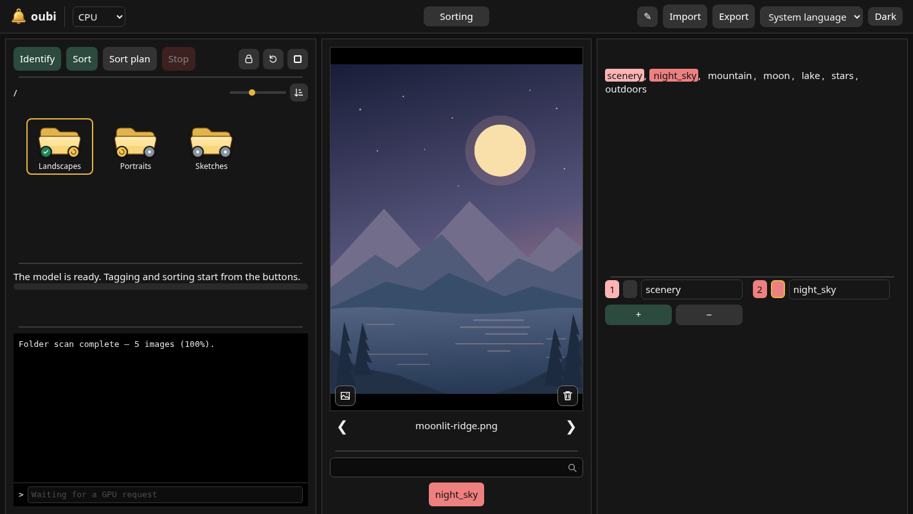

<div align="center">

  
  <h1>oubi</h1>

  [](https://www.gnu.org/licenses/gpl-3.0)
  [](https://github.com/yrmuq/oubi/pkgs/container/oubi)

</div>

---

> [!NOTE]
> This project is in active development. Behavior can change and bugs may occur. A finished `tags.csv` can become outdated. Delete `tags.csv` and the saved `.txt` files under each source folder’s `tags/` directory, then run tagging again.

---

`oubi` tags anime images with [PixAI Tagger v1.0](https://huggingface.co/pixai-labs/pixai-tagger-v1.0) and sorts them by series, rating, character, and selected genres. The self-hosted web interface runs in a CPU container. Tagging and sorting are separate steps, so you can sort again using saved tags.



---

## Features

- Select source folders, identify images, and preview saved tags in the browser.
- Resume tagging from `tags/<image filename>.txt`, such as `tags/photo.jpg.txt`. Set `OUBI_FORCE=1` to tag those images again.
- Plan a sort from `tags.csv`, then copy or move images. Numbered pages stay in their series and original art can be sorted by configured genres.
- Open a Cryptomator vault and choose whether sorted images stay inside it or go to the usual output folder.
- Filter the preview by tags, correct character genders through `genders.csv`, and customize the layout, theme, and language.

---

<details>
<summary><h2>Configuration</h2></summary>

| Input | Action |
| :--- | :--- |
| Folder tile | Click to select a source folder. Double-click or press Right Arrow to open its subfolders. Use the up arrow to return to the parent folder. |
| Folder size and order | Resize folder tiles with the slider. The order button reverses the default order of symbols, numbers, then letters. |
| Trash icon on the preview | Confirm permanent removal of the current image, its tag sidecar, and its index entries. |
| Recount icon | Rescan the active workspace. Use it to refresh the vault index after changes made outside Oubi. |
| Preview mode icon | Switch between the gallery of selected folders and the latest tagging result. Starting a job opens the work view. |
| `Identify` | Show the live count of images found in the selected folders, then the progress of checking existing tags and tagging the remaining images. |
| `Tagging device` | Choose CPU, AMD, or NVIDIA. Oubi selects an available installed GPU when the page opens. |
| `Install` / `Uninstall` | Install or remove components for the selected GPU. Confirm with `y` or cancel with `n` in the terminal. Shared CUDA packages stay available while another configured card uses them. |
| `Sorting` / `Gallery` | Switch between genre settings and favorite tag filters. Gallery hides the sorting controls and sorting badges. Returning to Sorting clears the active filters. |
| Default panel layout | Find tag search and active filters under the preview. Genre tags in Sorting and favorites in Gallery appear under the current image's tags. |
| `Import` / `Export` | Transfer favorites from the active library or the panel layout as JSON. Import merges favorites and replaces the panel layout. |
| Hold an image tag | Add or remove the tag from favorites. The Gallery groups saved tags by character or event. |
| `Sort` | Copy the selected folders' tagged images into their destinations. Set `OUBI_MOVE=1` to move them. |
| Lock icon | Unlock or lock the Cryptomator vault from the folder controls. |
| `Sort destination` | With the vault open, choose the destination for both sorting and its plan. |
| `Sort plan` | Show destination paths before copying or moving. A plan may write `unknown_genders.txt`. |
| `+` / `−` | Add a genre field or remove the last one, keeping at least one field available. |
| `OUBI_NO_TXT=1` | Skip writing tag sidecars. Resume relies on sidecars that already exist. |
| `OUBI_NSFW_FROM` | Use `q` to include `rating:q` and `rating:e`, or `e` to include only `rating:e`. |
| `OUBI_COPY_TXT=1` | Copy or move accompanying `.txt` files with sorted images. |
| `OUBI_BATCH_SIZE` | Set the number of images in a model pass. The CPU default is `1`. |
| `OUBI_MODEL` | Use a Hugging Face model ID or a model directory visible to the container. |
| `OUBI_GENRE_1`–`OUBI_GENRE_20` | Set initial genre tags in order. A saved genre list in the web interface takes precedence. |

Put optional gender overrides in `genders.csv` under the data directory as headerless rows like `hatsune_miku,f`. Copy entries from `unknown_genders.txt` into that file, add `f` or `m`, then sort again.

</details>

---

## Installation & Usage

### Architecture & Format Support

| Architecture | Status |
| :--- | :---: |
| `x86_64` | ✅ |
| `arm64` | ❌ |

The published container supports `linux/amd64` and uses CPU inference by default. The development build can download optional ROCm and CUDA environments from the web interface for compatible GPUs.

Select a GPU in the header and click its `Install` button. The terminal shows the selected bundle and estimated download size. Enter `y` to start or `n` to cancel. The shared progress bar and terminal show the installation steps, download speed, and estimated time remaining. After the GPU test passes, choose `AMD` or `NVIDIA` in the tagging device selector and click `Identify`.

### Release Scheme

Use the [latest stable release](https://github.com/yrmuq/oubi/releases/latest) for regular use and the [release list](https://github.com/yrmuq/oubi/releases) for versioned images. Stable releases are `X.Y.0` and publish `ghcr.io/yrmuq/oubi:latest`. Automated dependency prereleases use `X.Y.Z` with `Z > 0` and use their numbered tag. Development builds use `:dev`. All three channels run the web interface.

### Docker

Put the [Compose file](docker-compose.yml) and the [environment example](.env.example) in the same folder. Copy the example to `.env` and fill in your image and output paths, `LOCATION`, `PUID`, and `PGID`. The example uses `OUBI_CHANNEL=dev`. Set `OUBI_CHANNEL=latest` for the stable image.

Create the host directories for `/data`, `/cache`, and `/output`, and give your configured container user write access. The user also needs write access to the source folder when writing sidecars or moving originals.

Run these commands for installation and updates.

```bash
docker compose pull
docker compose up -d
```

Open `http://YOUR_SERVER:8080`, choose source folders, and use `Identify`, `Sort plan`, or `Sort`. To use a different host port, edit the left side of `8080:8080` under `ports` in the Compose file. For example, `8095:8080` opens Oubi on port `8095`. The application downloads model weights into `/cache` on startup. If the selected model requires Hugging Face authentication, set `HF_TOKEN` in your local `.env`.

Oubi writes tag sidecars, skips images that already have them, copies sorted images, and uses the `q` NSFW cutoff by default. Add a tagging or sorting override under `environment` in the Compose file only when you want to change that behavior.

| Container Path | Purpose |
| :--- | :--- |
| `/images` | Source images and optional tag sidecars. Keep this mount path because saved indexes use it. |
| `/output` | Sorted images. |
| `/data` | Saved tags, sorting history, gender overrides, web settings, and downloaded GPU environments. |
| `/cache` | Downloaded model weights, kept across image updates. |

#### AMD GPU tagging

Use the `dev` image with the [AMD Compose override](docker-compose.amd.yml). The Linux Docker host needs a compatible GPU and an AMD driver that exposes `/dev/kfd` and the card's render device. Run the following commands on the server that runs Docker. See the [ROCm Docker guide](https://rocm.docs.amd.com/projects/install-on-linux/en/docs-7.2.0/how-to/docker.html) for how device access works.

1. List graphics cards and their render devices. If `lspci` is missing, install the `pciutils` package on the server.

   ```bash
   lspci -D | grep -Ei 'VGA|3D|Display'
   ls -l /dev/dri/by-path/*-render
   ```

   Find your AMD card in the first list and note its PCI address at the start of the line. If it starts with `0000:03:00.0`, look for `pci-0000:03:00.0-render` in the second list. A link ending in `-> ../renderD128` means the device is `/dev/dri/renderD128`. Put that full path in `OUBI_AMD_RENDER_DEVICE`. Use the number shown for your own card.

2. Read the numeric group ID for each device. Replace `/dev/dri/renderD128` with the path you found.

   ```bash
   stat -c '%n %g' /dev/kfd /dev/dri/renderD128
   ```

   The number after `/dev/kfd` goes into `OUBI_KFD_GID`. The number after your render device goes into `OUBI_RENDER_GID`. If both numbers are the same, enter that number for both variables.

3. Fill the three AMD settings in `.env`. For example, if your device is `renderD128` and both group IDs are `105`, use:

   ```dotenv
   OUBI_AMD_RENDER_DEVICE=/dev/dri/renderD128
   OUBI_KFD_GID=105
   OUBI_RENDER_GID=105
   ```

   If either device is missing, check that the AMD driver is active on the host before starting the AMD override.

```bash
docker compose -f docker-compose.yml -f docker-compose.amd.yml pull
docker compose -f docker-compose.yml -f docker-compose.amd.yml up -d
```

Leave `OUBI_ROCM_ARCH=auto` to let Oubi detect the exposed AMD card. To find the code before installing the AMD packages, choose `Auto` in the AMD dropdown and click `Install`. The terminal shows the selected ROCm architecture, such as `gfx1102` for a Radeon RX 7600. Enter `n` if you only want to look up the code. To make that architecture the default selection, enter the code as `OUBI_ROCM_ARCH` in `.env`. Oubi stores ROCm packages in `/data/rocm`. The model cache is shared between the CPU and GPU tagging environments.

#### NVIDIA GPU tagging

Use the `dev` image with the [NVIDIA Compose override](docker-compose.nvidia.yml). The Linux Docker host needs a working NVIDIA driver and [NVIDIA Container Toolkit configured for Docker](https://docs.nvidia.com/datacenter/cloud-native/container-toolkit/install-guide.html).

Run `nvidia-smi -L` on the Docker host to check that the driver sees your cards. The NVIDIA override exposes them through the Container Toolkit. Pick the card by name in the Oubi header.

```bash
docker compose -f docker-compose.yml -f docker-compose.nvidia.yml pull
docker compose -f docker-compose.yml -f docker-compose.nvidia.yml up -d
```

With `Auto`, Oubi chooses a compatible card. It selects a PyTorch CUDA build using the card's compute capability and driver version. A downloaded build in `/data/nvidia` is shared by cards that use the same CUDA packages. Each selected card still runs its own GPU test.

#### Cryptomator vaults

Use the [Cryptomator Compose override](docker-compose.cryptomator.yml) with the `dev` channel on a Linux x86_64 host with FUSE. Set `OUBI_CRYPT` in `.env` to the full path on the server of the directory containing `vault.cryptomator`. The container user needs write access to that directory. FUSE requires a user name for the configured UID inside the container. The image provides one for the default UID `1000`.

```bash
docker compose -f docker-compose.yml -f docker-compose.cryptomator.yml pull
docker compose -f docker-compose.yml -f docker-compose.cryptomator.yml up -d
```

The standard Oubi image includes Cryptomator CLI and `fuse3`. The override mounts encrypted files at `/crypt` and enables FUSE access. It grants `SYS_ADMIN` and selects `apparmor:unconfined` for FUSE mounting. When Oubi finds `/crypt/vault.cryptomator` at startup, it shows a lock in the folder controls. Click it and enter the password to switch to vault folders in the current browser session. On the first unlock, Oubi builds `.oubi/index.sqlite3` in the vault and shows progress in the terminal. Later unlocks reuse that index for browsing, counts, search, and suggestions. Tagging, sorting, and deletion in Oubi update the affected entries. The recount control rebuilds the index from the files and tag metadata. Click the lock again after any active job finishes or stops to return to the ordinary source folders. Serve the web interface over authenticated HTTPS when accessing it remotely.

Set `OUBI_CRYPT_OUTPUT` to a path relative to the vault root, such as `Archive/Sorted`. It defaults to `Sorted` and is excluded from the vault's source scan. The external destination uses `OUBI_OUTPUT` and stores files outside Cryptomator encryption. Vault indexes, sort history, favorite tags, and gender overrides use the vault’s `.oubi/` folder.

Oubi saves gallery thumbnails on demand in `.oubi/thumbnails/`. Open a preview to load the original image. Deletion through Oubi removes the corresponding thumbnail, and a recount removes cached thumbnails whose originals were deleted elsewhere.

---

## License & Attribution

The scripts and `Dockerfile` in this repository are licensed under `GPL-3.0-only`. See [LICENSE](LICENSE).

| Component | Upstream | License | Integration Details |
| --- | --- | --- | --- |
| PixAI Tagger v1.0 | [pixai-labs/pixai-tagger-v1.0](https://huggingface.co/pixai-labs/pixai-tagger-v1.0) | `Apache-2.0` | Weights download into `/cache` when the app starts. |
| PyTorch | [pytorch/pytorch](https://github.com/pytorch/pytorch) | `BSD-3-Clause` | CPU build installed in the image. |
| Transformers | [huggingface/transformers](https://github.com/huggingface/transformers) | `Apache-2.0` | Loads the tagger pipeline. |
| timm | [huggingface/pytorch-image-models](https://github.com/huggingface/pytorch-image-models) | `Apache-2.0` | Required by the tagger model code. |
| Cryptomator CLI | [Cryptomator CLI 0.6.2 source](https://github.com/cryptomator/cli/tree/0.6.2) | `AGPL-3.0-only` | The upstream Linux x86_64 binary and its license ship with Oubi. The vault override enables mounting via FUSE. |
